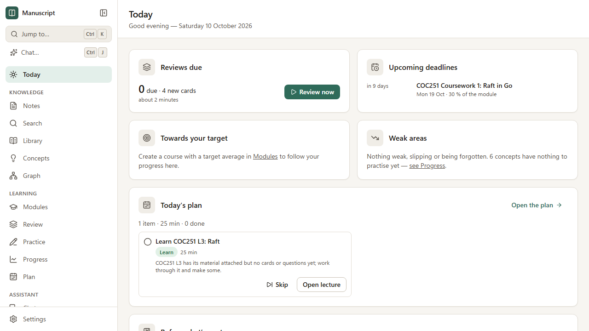
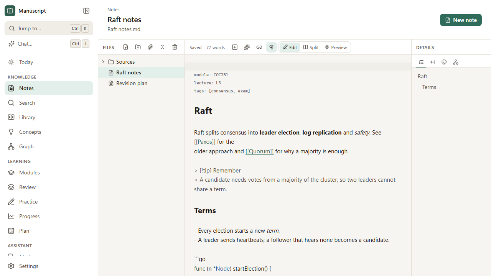
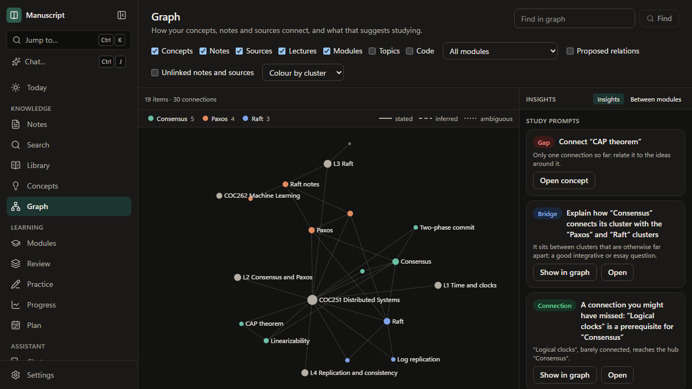
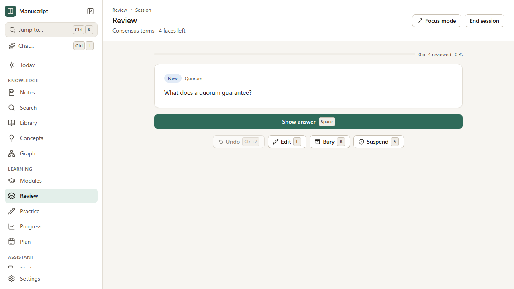
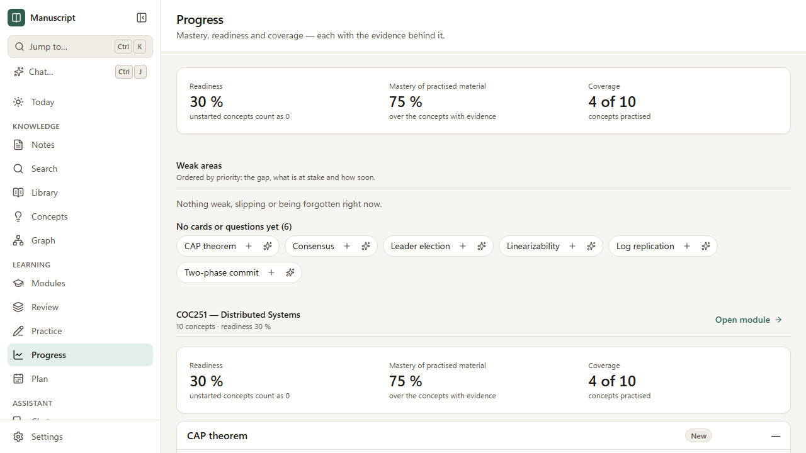

# Manuscript

A personal **Knowledge & Learning OS**: a Markdown knowledge base, a lecture/source library, a concept
graph and a spaced-repetition learning system that share one data model — with an AI agent that can
search, explain, generate study material and act on the knowledge base through permissioned tools.

> **Version 1.0.0** (11 October 2026). Notes, search, the source library, the course model, the
> knowledge graph, flashcards, practice, mastery and progress, the study plan, optional AI (answers with
> citations, generation, a tutor and an agentic chat with approvals and undo), export and restore,
> backups and diagnostics — in the browser and as a Windows desktop application with an installer.
> What changed: [`CHANGELOG.md`](./CHANGELOG.md); what works and what is open: [`STATE.md`](./STATE.md)
> and [`FEATURES.md`](./FEATURES.md); how to use it: the [user guides](./docs/guide/README.md).

## Getting started

| You want | Do this |
|---|---|
| **The desktop app** | Build the installer with `npm install` then `npm run desktop:dist`, and run `apps\desktop\release\Manuscript-Setup-1.0.0.exe` (per user, no administrator prompt; it is not code-signed, so Windows asks once: *More info → Run anyway*). See [Installing](./docs/guide/installing.md). |
| **It in your browser** | Double-click **`run-web.bat`**: it installs, builds and starts everything the first time, and opens the app signed in. |
| **To find your way round** | Start with [the study loop](./docs/guide/study-loop.md), then [your course](./docs/guide/course.md); press `?` in the app for the keys. |

Your notes are Markdown files in a folder you choose (`Documents\Manuscript` by default) — open them in
Obsidian or any editor at any time. Everything works without AI; add a provider in **Settings → AI** when
you want it.



| | |
|---|---|
|  |  |
| **Notes** — Markdown files in your vault, with live preview | **Graph** — how it all connects, and what to study next |
|  |  |
| **Review** — FSRS-6 flashcards from the keyboard | **Progress** — mastery you can check, never set by hand |

## Why it exists

Built by and for one final-year Computer Science & AI student aiming for an 85 %+ average. Note-taking
tools store knowledge but do not teach it back; AI study tools generate material in silos and rarely
schedule it. This project joins the two around the learning loop:

```text
lecture → concepts → knowledge graph → study material → practice → mastery → weak concepts → targeted study
```

## Core capabilities (see [FEATURES.md](./FEATURES.md) for the status of each)

- **Knowledge:** Obsidian-compatible Markdown notes (wikilinks, backlinks, maths, code, Mermaid), fast
  full-text search (and semantic retrieval for answers), a source library (PDF, PPTX, DOCX…) with page/slide-precise locators,
  concepts and a typed, provenance-tagged knowledge graph.
- **Learning:** modules, lectures, topics, assessments and a mark calculator; FSRS-6 flashcards;
  question bank, quizzes and mock exams; transparent concept-level mastery; weak-area detection; a
  deadline- and weight-aware study planner.
- **AI (optional):** grounded answers that cite your own sources; generation of notes, cards and
  questions with provenance; concept extraction as reviewable proposals; a guardrailed Socratic tutor;
  an agentic chat that acts through typed tools with approvals and undo; an MCP server for external
  agents. Provider-independent (Anthropic, OpenAI, OpenAI-compatible/local).
- **Data ownership:** notes are plain Markdown files; originals are preserved; structured data lives in
  an open SQLite file with full export.

## Architecture overview

```text
React SPA (apps/web) ──HTTP/SSE──► Local Node server (apps/server: Hono, node:sqlite, AI SDK 7)
                                        ├─► Vault folder: Markdown notes + original sources
                                        └─► <vault>/.skb/skb.db (structured data + rebuildable index)
Electron (apps/desktop) runs the same server and SPA as a desktop app.
```

Details: [`docs/prd/architecture.md`](./docs/prd/architecture.md).

## Setup

Requirements: **Windows 10/11** (macOS/Linux work for development), **Node.js 24+** with npm 11+, Git.

```powershell
git clone https://github.com/WilliamKyaww/manuscript.git
cd manuscript
npm install
```

## Running

| Mode | How | Notes |
|---|---|---|
| **Daily use (web)** | double-click **`run-web.bat`** | Installs dependencies and builds when needed, starts the server and opens your browser signed in. Running it again while the app is open just reopens the browser. |
| **Development** | `npm run dev` | API server on `http://127.0.0.1:4317` (auto-restarts) and Vite on `http://127.0.0.1:5317` (hot reload). Open the sign-in link printed by the server. Uses a disposable vault in `.dev-vault/` and app data in `.dev-data/`. |
| **Production server** | `npm run build` then `npm start` | Serves the built app and API on port 4317. |
| **Desktop (development)** | `npm run desktop:dev` | The same application in its own window (Electron 44): the server runs in a background process of the window, you are signed in, and **Settings → Data** gets *Browse…* and *Show in folder*. Needs the built application (it builds it when missing). |
| Desktop (unpacked build) | `npm run desktop:build` | Lays out `apps/desktop/release/<platform>-unpacked/Manuscript.exe`: Electron's distribution plus the shell and the server. Runs without Node.js installed. |
| **Windows installer** | `npm run desktop:dist` | Writes `apps/desktop/release/Manuscript-Setup-<version>.exe` (NSIS, per user, no administrator prompt; your vault and data are not part of it and are kept on uninstall). It is **not code-signed** unless `CSC_LINK` and `CSC_KEY_PASSWORD` are set, so Windows SmartScreen shows "Windows protected your PC" the first time: choose *More info → Run anyway*. See [Installing](./docs/guide/installing.md). |

**Where data lives (web and desktop):** the vault (your notes and sources) defaults to
`Documents\Manuscript`; settings and the local sign-in token live in
`%APPDATA%\Manuscript` (never inside the vault). The project used to be called "Study Knowledge
Base": if only the old folders (`Documents\Study Knowledge Base`, `%APPDATA%\StudyKnowledgeBase`)
exist, they keep being used. To switch to the new names, close the app and rename the folders.

**Configuration** (flags override environment variables): `--port` / `SKB_PORT`, `--vault` /
`SKB_VAULT`, `--data-dir` / `SKB_DATA_DIR`, `--log-level` / `SKB_LOG_LEVEL` (`debug`, `info`, `warn`,
`error`), `--open` (open the browser). `SKB_NO_BROWSER=1` stops `run-web.bat` opening a browser.

**Security:** the server listens on `127.0.0.1` only and every API call needs the local token (sent as an
HttpOnly cookie after you open the sign-in link). Requests with a foreign `Host` or `Origin` are refused.

## Testing

| Command | What it checks |
|---|---|
| `npm test` | Unit, integration and component tests (Vitest) |
| `npm run typecheck` | TypeScript 7 across all packages and the E2E suite |
| `npm run lint` / `npm run format` | Biome lint and format (check / write) |
| `npm run test:smoke` | Starts the built server bundle and checks ping, auth, health and the SPA |
| `npm run test:e2e` | Builds, then Playwright end-to-end tests in Chromium (first run: `npx playwright install chromium`) |
| `npm run test:perf` | Generates 10,000 notes (and 10,000 PDF pages) and checks the indexing, search, graph and retrieval budgets (run on an idle machine: timings vary with load) |
| `npm run test:perf:mastery` | A year of simulated learning; checks the mastery pass (budget 500 ms) |
| `npm run test:soak -- --minutes 480` | The built server for hours through imports, search, notes and reviews; fails on an error, a growing live heap or a broken budget |
| `npm run report:calibration -- <vault>` | How well predicted recall matches what happened in a vault's reviews (read-only); `-- --simulate` for simulated students |
| `npm run eval:ai` | Fifty questions on eight documents: retrieval with the test model, or a real model's answers and citations with `SKB_EVAL_PROVIDER`, `SKB_EVAL_MODEL`, `SKB_EVAL_API_KEY` |
| `npx playwright test e2e/desktop.spec.ts` | Launches the desktop shell and its unpacked build with Playwright's Electron driver (needs `npm run build`, and `npm run desktop:build` for the second test) |
| `SKB_SCREENSHOTS=<folder> npx playwright test e2e/screens.spec.ts` | Seeds a realistic course and photographs every screen in both themes (`SKB_SCREENSHOT_WIDTH` sets the width; needs `npm run build`) — how the pictures here were made |
| **`npm run verify`** | typecheck → lint → tests → build → smoke test (run before every commit) |

## Troubleshooting

- **"Port 4317 is already in use"** — the app is probably already running; use `run-web.bat` to reopen
  it, or set `SKB_PORT`.
- **"Sign-in required"** in the browser — open the link printed in the server window, or start the app
  with `run-web.bat`, which signs you in automatically.
- **"This vault is already open in another process"** — close the other instance; after a crash the lock
  is recovered automatically on the next start.
- **"This note was changed outside the editor"** — another program saved the note while you had unsaved
  changes. Nothing has been overwritten: use **Compare**, then keep your version or reload theirs.
- **A note opens read-only** — the file is not UTF-8 text or is larger than about 5 MB; edit it in another
  program or convert it to UTF-8.

## Documentation

| Where | What |
|---|---|
| [`CHANGELOG.md`](./CHANGELOG.md) | What each release changed; the 1.0.0 release notes |
| [`STATE.md`](./STATE.md) | Current state of the project |
| [`FEATURES.md`](./FEATURES.md) | Feature inventory and statuses |
| [`DECISIONS.md`](./DECISIONS.md) | Architecture decision records |
| [`docs/guide/`](./docs/guide/README.md) | User guides: one per part of the application, from installing to troubleshooting |
| [`AGENTS.md`](./AGENTS.md) | How to work on this repository (agents and humans) |
| [`docs/`](./docs/README.md) | Research, PRD, checklists, journal, backlog |

## Licence and notices

Personal project; licence to be decided by the owner. Third-party notices (including ideas adapted from
[Graphify](https://github.com/Graphify-Labs/graphify), Apache-2.0) are in
[`THIRD_PARTY_NOTICES.md`](./THIRD_PARTY_NOTICES.md).
