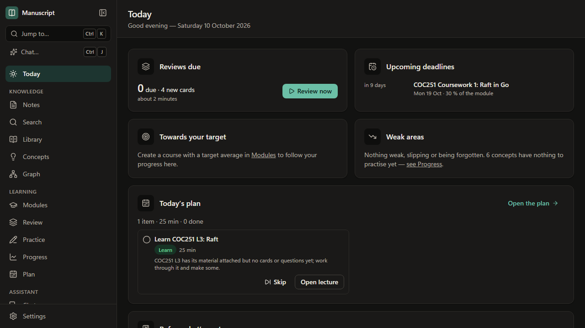

# User guides

Written for people using Manuscript, not for developers: what each part does, how to use it, and what
it leaves to you. Everything except the AI guides works without an AI model.

**New to Manuscript?** Install it ([Installing on Windows](./installing.md)), read [the study loop](./study-loop.md)
for how the pieces fit together, then set up [your course](./course.md) and start writing [notes](./markdown.md).
Press `?` anywhere in the application for its keyboard shortcuts.

### Getting started

| Guide | Covers |
|---|---|
| [Installing on Windows](./installing.md) | Building the installer, what it installs and what it leaves alone, the SmartScreen warning, first run, updating in place, uninstalling |
| [The desktop app](./desktop.md) | Starting it, what the window adds (Browse…, Show in folder, restarting to open another vault), what it keeps to itself, how AI keys are protected, what to do if the engine stops |
| [Appearance](./appearance.md) | Light and dark, the six colour palettes, and Simplified UI: what it quietens and what it keeps |
| [The study loop](./study-loop.md) | How the pieces fit together: lecture, study materials, graph, practice, mastery, plan and notes — and what stays in your hands |

### Notes and material

| Guide | Covers |
|---|---|
| [Notes and Markdown](./markdown.md) | The Markdown dialect, links and backlinks, properties, note ids, templates, attachments, saving and conflicts, renaming and the trash, which files are indexed, differences from Obsidian, keyboard shortcuts |
| [Searching and finding notes](./search.md) | The quick switcher (Ctrl+O), the command palette and full-text search (Ctrl+Shift+F): syntax, filters, ranking |
| [Lecture material: the library](./sources.md) | Importing slides, PDFs and documents, supported formats and limits, reading them, searching them down to the page or slide, organising the `Sources` folder by hand, retrying and deleting |
| [The knowledge graph](./graph.md) | What the graph shows, clusters and line styles, finding and filtering, paths, relations between concepts and reviewing them, study prompts, local graphs |

### Learning

| Guide | Covers |
|---|---|
| [Your course](./course.md) | Courses, modules and their codes, assessments and the mark calculator, lectures and their material, topics, concepts and links to them, the Today widgets |
| [Flashcards and reviewing](./flashcards.md) | Card sets, basic, reversed and cloze cards, writing good cards, cards from notes and sources, the keyboard review session, statistics, review settings, Anki import and export |
| [Practice](./practice.md) | Writing questions of each kind, the question bank, practice quizzes, mock exams, Learn sessions, grading your own answers, retakes and Markdown export |
| [How mastery is worked out](./mastery.md) | Recall and accuracy, the mastery formula with a worked example, confidence and stages, readiness and coverage, weak areas and priority, limitations, checking the predictions against your own reviews |
| [The study plan](./planning.md) | Availability, making and remaking the plan, what each kind of item means and how long it takes, how priority is worked out, remembering more before an exam |

### AI (optional)

| Guide | Covers |
|---|---|
| [AI](./ai.md) | Setting up providers and models, asking about your material with citations, semantic search and similar notes, privacy, costs and the monthly budget, test mode, measuring how well a model answers from your material |
| [Chat](./chat.md) | The chat page and side panel (Ctrl+J), asking and acting, tutor mode and quizzes, modes and scopes, activity rows, approvals, result cards and Undo, @mentions and the page context, long conversations, checking with a real provider |
| [Generating with AI and the Inbox](./generation.md) | Flashcards, questions, lecture notes and concepts from a lecture, source, note or selection; the estimate; quality rules; reviewing drafts and suggestions; auto-accept; link suggestions; AI grading; recordings, images and scanned pages |
| [The assistant's tools, approvals, undo and MCP](./agent-tools.md) | What the assistant may do and what always asks you first, seeing and undoing its changes, connecting Claude Code or Claude Desktop over MCP, the full tool list |

### Your data, and when something is wrong

| Guide | Covers |
|---|---|
| [Your data: leaving, moving and bringing things in](./portability.md) | What lives where, exporting everything in open formats, restoring into a new vault, concepts as notes, opening another vault or an Obsidian vault in place, importing a Graphify graph of a repository |
| [When something is wrong](./troubleshooting.md) | Messages at start-up and what to do, files that cannot be written or read, a damaged database and how to go back to a backup, AI that cannot be reached, the diagnostics bundle |

## Folder names after the rename

Manuscript was first called "Study Knowledge Base". If you used it before the rename, your vault is
still in `Documents\Study Knowledge Base` and your settings in `%APPDATA%\StudyKnowledgeBase`, and the
app keeps using them as long as no `Manuscript` folders exist. To move to the new names, close the
app (and `run-web.bat`), then rename `Documents\Study Knowledge Base` to `Documents\Manuscript` and
`%APPDATA%\StudyKnowledgeBase` to `%APPDATA%\Manuscript`. Nothing inside them needs to change.
