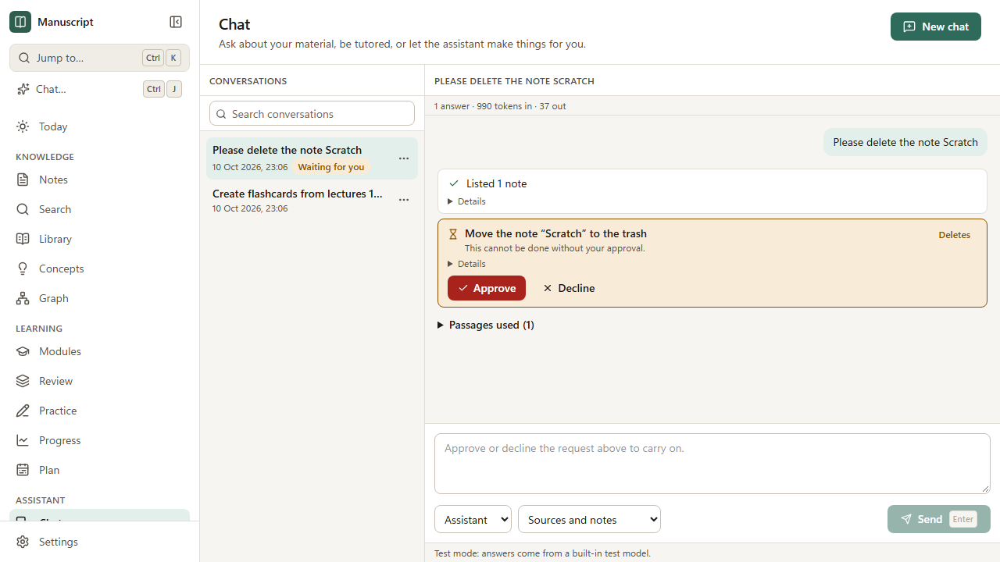

# Chat

Chat is where you ask about your material and ask the assistant to do things with it: make flashcards
from lectures, write a summary note from your slides and your own notes, turn a note into a quiz.
Answers come from your sources and notes, with citations. Anything the assistant changes is shown as
it happens and can be undone, and anything that deletes asks you first.

Chat needs an AI model. Without one, you can still read your old conversations, and the message box
says what is missing; everything else in Manuscript works as before. Set a model up in
**Settings → AI** ([AI](./ai.md)).

## Two places to chat

- **The side panel.** Press **Ctrl+J** (or **Chat…** in the sidebar, or *Chat about your material* in
  the command palette) on any page. The panel opens beside the page, so you can keep reading while you
  ask. **Esc** closes it; the **Open in the Chat page** button moves the conversation to the full page.
  On the Chat page, Ctrl+J puts the cursor in the message box instead.
- **The Chat page** (`/chat`). A list of every conversation on the left, which you can search (it looks
  at titles and at what was said), rename and delete, and the open conversation beside it.

A conversation is kept in the app's database, not in your vault. Deleting one deletes its messages
only: anything the assistant made stays, and can still be undone from
**Settings → Assistant actions** ([Assistant tools](./agent-tools.md)).

## Asking and acting

Type a message and press **Enter** (**Shift+Enter** for a new line). Some things to try:

- *How does Raft elect a leader?* — a cited answer from your lecture material.
- *Create flashcards from lectures 1–3* — the assistant finds the lectures, reads their material and
  makes the cards. They wait in the **Inbox** as drafts until you accept them.
- *Write a Markdown summary of consensus from Lectures 1–4, expanded with my notes* — a new note,
  linked to your own notes it used.
- *Explain this page in simpler terms* — with a page open, the assistant knows which page it is.

### Mode

| Mode | What it does |
|---|---|
| **Assistant** | Answers, and can make notes, cards and quizzes. Asks before anything that deletes or changes a lot. |
| **Tutor** | Guides you with questions and hints instead of giving the answer away. It can make cards and quizzes for you. |
| **Read only** | Answers from your material and changes nothing. |

### Answer from

The same three choices as in [AI](./ai.md#2-asking-about-your-material): **My sources**, **Sources and
notes**, **General knowledge too**. The mode and this choice belong to the conversation; change them
between messages if you like.

## Tutor mode

Choose **Tutor** as the mode and the assistant stops answering and starts guiding. It follows a ladder,
and Manuscript — not the model — decides which rung a reply may use:

1. **A question first.** It asks what you already know and where you are stuck. It never opens with the
   solution.
2. **A hint**, then **a stronger hint**, if you are still stuck.
3. **The first part of the solution**, leaving the last step to you.
4. **The full worked solution — only when you ask for it** in so many words ("show me the solution",
   "I give up"). It always ends with a **Check question:** for you to answer, and the ladder starts again
   afterwards.

It uses your own notes and lecture material, with citations.

**Quiz me.** Say "quiz me on Raft" and it puts questions from your own question bank one at a time,
showing the question and its options but never the answer. When you reply, it asks to **record your answer**
as evidence for your mastery. You see exactly what will be recorded and can approve it once, approve it for
the rest of the chat, or decline. Recording is permanent — an answer is evidence and cannot be undone — and is
marked as *assisted*, so it counts for less than an answer you gave unaided. The tutor then shows the right
answer and the explanation. The questions of a tutored chat are kept in a quiz of their own (not listed with
yours) so they appear in the concept's answers on the Progress page.

**Check my notes.** Ask "check my notes on Raft against the lectures". If a note says something the lecture
material contradicts, the tutor puts a **suggested correction** in your Inbox, with the lecture's words as
evidence. Your note is not changed until you accept it, and you can decline.

## What you see

- **Citations.** A claim from your material ends in **[S2]**. Click it to open the PDF page, the
  slide or the line in your note. **Passages used** lists everything the model was given. The label
  under the answer says how grounded it is (*From your sources*, *Partly general knowledge*,
  *General knowledge*), and citations to passages the model was not given are removed and listed.
- **Activity.** Every step the assistant takes is a row: *Listed 3 notes*, *Read “Consensus.pptx”*,
  *Created 12 flashcards in “CS301 · L1–L3”*. A spinner shows what is running. **Details** shows the
  exact arguments and what came back.
- **Result cards.** When the assistant made something, the row has buttons that open it (**Open note**,
  **Review in the Inbox**, **Open card set**, **Open Practice**) and **Undo**. Undo is refused if you
  have changed the thing since, so it never overwrites your work.
- **Stop.** The **Stop** button ends a run. What was done so far stays, and is listed.
- **Usage.** Above the conversation: how many answers, how many tokens, and about what it cost.

## Approvals

Reading and searching never ask. Changes that can be undone run and are logged. These always ask
first:

- deleting or merging anything;
- any change to more than twenty things at once;
- any tool you have set to *Ask each time* in **Settings → Assistant actions**.

An approval card says exactly what will happen. You can **Approve** it once, **Approve for this
chat** (the assistant may then use that tool without asking again in this conversation; **Ask again**
above the conversation takes that back), or **Decline**. Deleting and merging can only be approved once
at a time — there is no “for this chat”. If you decline, the assistant accepts it and carries on
without. While a question is waiting, the conversation does not take a new message; the question is
saved, so it is still there if you reload the page or close the app.

## Pointing at things

- Type **@** in the message box and a few letters to **mention** a note, concept, module, lecture or
  source. Arrow keys and **Enter** (or a click) choose one. The mention narrows where the answer looks and
  tells the assistant what you mean.
- With a source, module, lecture or concept page open, **Only this …** is ticked: the answer is about
  that page. Untick it to look further. The open note is always known to the assistant, which can read
  it when it helps.
- **Select text** on a page and then open the panel (Ctrl+J): the selection is offered with your next
  message as **Selected text**, and you can remove it before sending.

## Long conversations

When a conversation grows beyond what the model can read at once, the older turns are summarised (by
the quick-tasks model if you set one) and the latest turns are kept word for word. You still see the
whole conversation; the line above it says earlier messages are summarised for the model.

## Privacy

What is sent to your provider is the same as for Ask: your message, the passages found for it, the
conversation so far (or its summary), and what the assistant's tools return. Text from your own files
is passed as material to read, never as instructions, and the rules about what asks first are enforced
by Manuscript itself, not by the model. Nothing the assistant does sets a mastery figure or records an
answer for you.

## Checking it against a real provider

The automated tests use a built-in test model (`SKB_AI_PROVIDER=mock`), which plans the examples
above. A real model decides for itself, so it is worth trying once by hand after setting one up:

1. Add a provider and a model for **Answers** in **Settings → AI**, and press **Test**.
2. Import a lecture PDF or slides, put them in a lecture of a module, and ask a question about them:
   the answer should cite a page that opens, and be labelled *From your sources*.
3. Ask for flashcards from the lecture: activity rows appear, and the cards wait in the Inbox.
4. Ask it to delete a throw-away note: an approval card appears, and the note is still there until
   you approve. Decline, then try again and approve; use **Undo** to bring it back.
5. Ask for a summary note that uses your own notes, and check it links to them.

If something fails, **Details** on the activity row shows what was asked of the tool and what came back.
