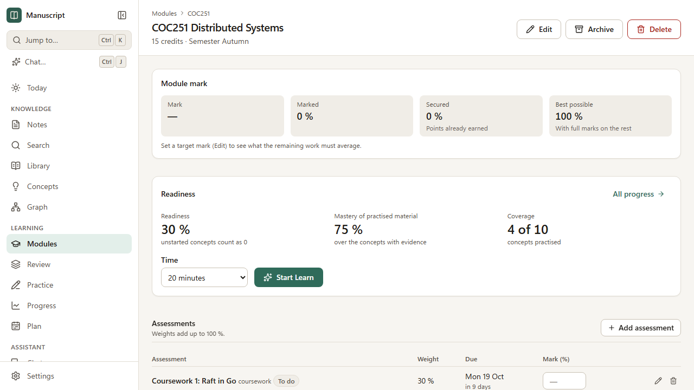

# Your course: modules, lectures, assessments and concepts

**Modules** (sidebar, or `/modules`) holds the structure of what you are studying: the modules you
take, their lectures, how they are assessed and the ideas — **concepts** — they teach. From the marks
you enter, Manuscript works out what you still need for your targets.



A semester takes a few minutes to set up: a course, its modules, then each module's assessments. Add
lectures as the term goes on.

## 1. A course and its target average

**New course** creates a course, for example "Year 3 — Computer Science and AI", with its start and end
dates and the **target average** you are aiming for (say 85 %). A course groups modules; its average is
weighted by credits, so a 40-credit module counts twice as much as a 20-credit one.

The pencil beside a course's name edits it. Modules without a course are listed on their own.

## 2. Modules

**New module** asks for:

| Field | Example | Notes |
|---|---|---|
| Code | `COC251` | Unique, whatever the capitals. It is how files refer to the module (below) |
| Title | Distributed Systems | |
| Credits | 20 | Used to weight the course average |
| Semester | 1, or `1–2` | Free text |
| Target mark | 80 | The mark you want in this module |
| Course | Year 3 | Optional |
| Colour | | Marks the module's card |

**The code links the module to your files.** Sources imported with that module go into
`Sources/COC251/`, and a note belongs to the module when its `module` property is `COC251`. Nothing
is copied into the app: the module page simply lists those files. For that reason the code cannot be
changed while files refer to it — rename the `Sources/COC251` folder and update the notes' `module`
property first.

**Archive** moves a finished module to the *Archived* list and out of the upcoming deadlines; its
marks still count towards its course's average. For a module you have dropped, edit it and set
**Course** to *No course*, so that it no longer counts. **Delete** removes its lectures, topics and
assessments; notes, sources and concepts stay.

## 3. Assessments and the mark calculator

On a module's page, **Add assessment** for each exam, coursework, test, presentation or project, with
its **weight** (its share of the module mark, in per cent), its due date (and time) and, once you have
it, the **mark**. Weights may add up to at most 100 %; if they add up to less, the rest counts as still
to come.

Type a mark straight into the **Mark (%)** column and press Enter (or leave the field) to save it; clear
it to remove it. The pencil edits an assessment; tick **Submitted, waiting for the mark** for work you
have handed in, so that it leaves the upcoming deadlines.

The calculator above the table shows:

| | Meaning |
|---|---|
| **So far** | The average of the marks you have, weighted by their weights (**Final** once everything is marked) |
| **Marked** | How much of the module is marked |
| **Secured** | Points already earned: marks × weights. Even zeros on the rest cannot take these away |
| **Best possible** | What you would finish with if you got full marks on everything left |

and one sentence about the target, for example:

- *Needs an average of 81.3 % on the remaining 60 % for 80 %.*
- *80 % is already secured.*
- *80 % is out of reach: the best still possible is 76 %.*
- *Finished at 78 %, below the target of 80 %.*

A worked example: coursework worth 40 % marked 78, and an exam worth 60 % still to come. So far
78 %; secured 0.4 × 78 = 31.2; for 80 the exam needs (80 − 31.2) ÷ 0.6 = 81.3 %. The course card does
the same across modules, with each module's share being its credits.

## 4. Lectures

**Add lecture** suggests the next key (`L01`, `L02`, …; any key works, such as `Lab2`) and asks for a
title, kind (lecture, lab, tutorial, seminar, workshop), week and date. Keys are unique within a module.

A lecture's page brings its material together:

- **Sources** — choose a source from the library and **Attach** it (slides, handouts, readings). This
  is recorded by the app; the file stays where it is.
- **Notes** — **New lecture note** creates `L03 Consensus` in `Modules/COC251/`, optionally from a
  template, with the `module` and `lecture` properties set. **Attach** an existing note by title: that
  writes the same two properties into the note.
- **Concepts** — the concepts the lecture's notes link to.

**A note's properties are the record.** A note belongs to a lecture when it says so:

```yaml
---
module: COC251
lecture: COC251/L03    # or just L03, since the module is given
---
```

So you can file notes from Obsidian or any editor too, and detaching a note on the lecture page just
removes its `lecture` line. A lecture's key cannot be changed while notes refer to it.

## 5. Topics

**Topics** organise a module's content as a tree: type a name, choose where it goes (*At the top
level* or inside another topic) and **Add topic**. Concepts can belong to topics. Deleting a topic
deletes the topics inside it.

## 6. Concepts

A **concept** is an idea you are learning: Paxos, the CAP theorem, back-propagation. Later phases hang
flashcards, questions and mastery on concepts; for now they connect your notes and sources.

Create one from **Concepts › New concept**, from the box at the bottom of a module page, or straight
from a note: in the preview, select a link that does not lead anywhere yet, such as `[[Anti-entropy]]`,
and choose **Create concept** (or **Create note**, as before). A concept has:

- a **name** and **aliases** (other names, separated by commas) — no two concepts share a name or alias,
  whatever the capitals;
- a short **summary** (Markdown and maths work), an **importance**, its **modules** and **topics**;
- optionally a **backing note** that explains it in depth.

**Links.** `[[CAP theorem]]` or `[[Brewer's theorem]]` in any note links to the concept — unless a
note is called that, because notes come first (see [links](./markdown.md#2-links-and-how-they-are-resolved)).
Concept links are shown with a dotted underline and open the concept page.

The **concept page** lists its **relations** to other concepts (*is a prerequisite for*, *is part
of*… — see [the graph guide](./graph.md#4-relations-between-concepts)), its **connections** one or
two steps out, the notes linking to it, with the lines that mention it, and passages in your
sources that name it or one of its aliases — each opens the source at that page or slide.
Renaming a concept or changing its aliases updates which links resolve to it; deleting it leaves the
links in your notes as they are, unresolved again.

Concepts live in the app's database (`.skb/`), not in your vault. Phase 16's export writes them out;
until then a backing note is the place for anything you would not want to lose.

## 7. On the Today page

- **Upcoming deadlines** — assessments due in the next fortnight that are not submitted or marked,
  with how many days are left and what they are worth.
- **Towards your target** — the current course's average so far and what the rest needs to average
  for your target.

## Coming later

- Flashcards and questions per concept and lecture (Phases 8–9), and mastery per concept (Phase 9).
- Suggested concepts from your notes and sources, and merging duplicates (Phase 11).
- A study plan built from deadlines, weights and weak concepts (Phase 14).
