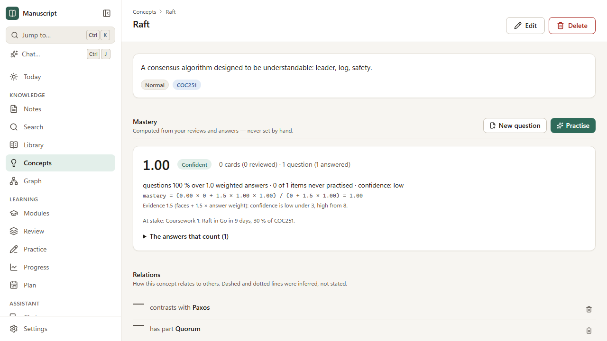

# How mastery is worked out

Manuscript measures how well you know each **concept** from what you have actually done: reviewing
flashcards and answering questions. Nothing is set by hand or by AI, and every figure shows the
numbers it came from, so you can check it yourself. This page explains them. (The design is in
`docs/prd/learning-system.md` §7–9 and ADR-0021.)



## 1. One concept

Two kinds of evidence count, both from items **linked to the concept**:

**Recall** — for each card face you have reviewed (a reversed card has two faces, a cloze card one
per gap), FSRS estimates the chance that you remember it *right now*. Recall is the average of those
chances, over *n* faces. It falls day by day until you review again.

**Accuracy** — your scores on the **last 20 answers** to linked questions (right = 1, partly = ½ or
your partial credit, wrong = 0). Each answer is weighted:

- by age: its weight halves every **21 days** (counting whole days from 04:00, so an answer given
  today weighs 1, three weeks ago ½, six weeks ago ¼);
- by help: an answer given after using the hint (or opening the source) counts **half**.

Accuracy is the weighted average of the scores, and *w* is the total weight. If *w* is below 0.5 —
only old or helped answers — accuracy is left out.

**Mastery** combines them, counting questions 1.5 times as much as cards (they test understanding,
not only recall):

```text
mastery = (recall × n + 1.5 × accuracy × w) / (n + 1.5 × w)
```

With only one kind of evidence, mastery is that one. With neither, the concept is **New**.

### Example

Two reviewed faces with chances 0.9 and 0.7 give recall 0.80 from 2 faces. A right answer today
(weight 1) and a wrong one 21 days ago (weight ½) give accuracy (1 × 1 + 0 × ½) / 1.5 = 0.67 over
weight 1.5. Mastery = (0.80 × 2 + 1.5 × 0.67 × 1.5) / (2 + 1.5 × 1.5) = 3.1 / 4.25 = **0.73**.

The concept page shows exactly this: *recall 0.80 from 2 card faces · questions 67 % over 1.5
weighted answers · …*, the sum with the numbers in it, and every answer that counts with the weight it
carries today.

## 2. Confidence and stage

**Evidence** is *n* + 1.5 × *w*. Confidence is **low** below 3, **medium** from 3 and **high** from 8
— a figure from two answers says less than one from twenty.

| Stage | When |
|---|---|
| New | No evidence yet |
| Learning | Mastery below 0.60, or any linked card being learnt or relearnt |
| Practised | 0.60 to 0.80 |
| Confident | 0.80 to 0.90, or above 0.90 without high confidence |
| Mastered | 0.90 or more, high confidence, and the reviewed cards (if any) last: their median stability is at least 21 days |

**Coverage** is how many of the linked cards and questions you have practised at least once.

## 3. Topics, modules and the course

Each concept counts by its **importance** (½ to 2, set on the concept). For a topic (with its
subtopics), a module or the whole course:

- **Mastery of practised material** — the average over concepts with evidence;
- **Readiness** — the same with concepts you have not started counted as 0: the honest figure for an
  exam;
- **Coverage** — how many of the concepts you have practised.

Progress shows all three for the course, each module (not archived ones) and topic; module pages show
them under **Readiness**.

## 4. Weak areas

A concept is listed as a weak area when:

| Signal | Rule |
|---|---|
| Weak | Mastery below 0.60 with at least medium confidence |
| Slipping | Accuracy over the last 14 days is 20 points or more below the 14 days before (at least two answers in each fortnight) |
| Lapsing | Two or more of its cards forgotten in review in the last 14 days |
| Forgotten | Recall below 0.70 now after at least 0.85 a fortnight ago |
| At risk | A concept this one builds on (a prerequisite) was answered wrongly in the last 14 days |

Concepts with **no cards or questions** are listed separately, with a button to write a question.

Weak areas are ordered by **priority**:

```text
priority = (1 − mastery) × stake × urgency × importance
stake    = the assessment's weight × the module's credits / all modules' credits
urgency  = 14 / days until the assessment, kept between 0.25 and 3
```

The assessment is the module's next planned one with a date that matters most. A module with no
dated assessment counts as its whole mark at the lowest urgency; modules without credits count as the
average of the others. Learn uses the same priority to choose concepts.

### Credit along prerequisites

When you state that one concept is a **prerequisite for** another (and accept the relation), what you
show on the second says something about the first:

- A **correct answer** on a concept counts a little towards the concepts it builds on, as if they had
  been asked about too. Each step along the prerequisite edges multiplies it by the edge's weight (0.2
  unless the relation says otherwise, never more than 0.3), up to two steps. The concept's explanation
  lists it: *"Implicit credit from “Raft”: 4 correct answers × 0.20"*, and the answer weight says how
  much of it is credit.
- Credit only counts for a concept that has something to practise, and never when your **own** recent
  accuracy on that concept is below 60 %: a shaky prerequisite needs practice of its own.
- A **wrong answer** on a prerequisite puts the concepts that build on it **at risk**: their priority is
  raised by a quarter and they appear in the weak areas with the reason. Their scores do not change.

Credit is one more kind of answer in the sum, weighed by age and help like any other, so you can still
check every figure by hand.

## 5. Limitations

- Mastery measures **your practice**, not your understanding directly. Concepts with few linked
  cards and questions get low-confidence figures; write a few more questions to firm them up.
- Questions you grade yourself are only as honest as your grading.
- Recall comes from FSRS's estimate for an average learner until per-user optimisation arrives
  (backlog B-LE-10).
- *Forgotten* fires mostly for cards that were never learnt well: FSRS-6 forgets slowly, so a card
  that was well learnt rarely falls that far within a fortnight. *Weak* and *Lapsing* catch the rest.
- Credit follows only relations you have stated or accepted, and only `prerequisite for`; a missing
  relation means no credit.
- Figures are recalculated after every review and answer, and every quarter of an hour otherwise, as
  recall keeps falling while you do nothing.
