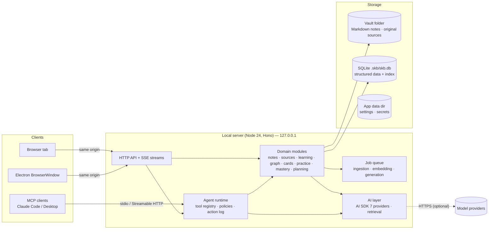

# Architecture

> PRD v0.1 — 4 October 2026. Decisions referenced as ADR-NNNN are in `/DECISIONS.md`.

## 1. Shape of the system

**One local Node.js server owns all data and logic; one React single-page app is the UI; Electron is a
thin desktop shell around the same two.** (ADR-0002, ADR-0003)



### Run modes

| Mode | Processes | How it starts |
|---|---|---|
| **Development** | `tsx watch` server on `127.0.0.1:4317`; Vite dev server on `127.0.0.1:5317` proxying `/api` (5317 avoids clashing with other Vite projects on 5173) | `npm run dev` |
| **Local web (daily use)** | Built server serving the built SPA and API on one port | `run-web.bat` or `npm start` |
| **Desktop** | Electron main process → server in an Electron `utilityProcess` → `BrowserWindow` loads the server URL | `npm run desktop:dev`; packaged installer |

The UI never talks to the filesystem or database directly in any mode; it only calls the HTTP API.
Electron adds a minimal preload bridge for native capabilities (file/folder pickers, reveal in
Explorer, app info) and secure secret storage.

## 2. Repository structure

```text
manuscript/
├── apps/
│   ├── server/          @skb/server  — Hono API, domain modules, agent, jobs (Node)
│   ├── web/             @skb/web     — React SPA (Vite)
│   └── desktop/         @skb/desktop — Electron main + preload (Phase 18)
├── packages/
│   └── core/            @skb/core    — shared Zod schemas, types, pure logic (links, ids, mastery maths)
├── docs/                PRD, research, checklist, journal, backlog
├── scripts/             build and maintenance scripts
├── e2e/                 Playwright end-to-end tests
├── README.md  AGENTS.md  CLAUDE.md  FEATURES.md  DECISIONS.md  STATE.md  THIRD_PARTY_NOTICES.md
└── run-web.bat
```

Further packages are split out only when two apps genuinely share code (avoid premature packaging).

## 3. Server: a modular monolith

```text
apps/server/src/
├── main.ts              process entry: config → vault → db → http
├── app.ts               Hono app composition (middleware + module routes)
├── context.ts           AppContext: { config, logger, clock, ids, vault, db, events }
├── config/              config resolution (env, app data dir, CLI flags)
├── security/            token auth, host/origin guards, path containment
├── db/                  node:sqlite adapter, migrations runner, transaction helper, migrations/*.sql
├── vault/               layout, atomic file IO, watcher, locks, trash, history snapshots
├── jobs/                persistent job queue (SQLite-backed) + worker loop + progress events
├── modules/
│   ├── notes/           files ⇄ index, frontmatter, links, tags, templates
│   ├── search/          FTS5 indexing and query, hybrid fusion (later)
│   ├── sources/         library, ingestion pipeline, parsers/, chunking
│   ├── learning/        courses, modules, lectures, topics, assessments
│   ├── concepts/        concepts and aliases (proposals in Phase 11)
│   ├── graph/           relations, graph assembly (graphology), analytics, queries
│   ├── cards/           flashcards, FSRS scheduling, review logs, export
│   ├── practice/        questions, quizzes, attempts, grading, Learn sessions (Phase 9)
│   ├── mastery/         evidence aggregation, roll-ups, weak areas, priority, mastery_cache
│   ├── planning/        study plans, sessions
│   ├── ai/              store (ai.json, secrets.json), registry, mock models, usage, embeddings/,
│   │                    retrieval (fusion), ask (grounded answers, JSON-line stream); generation later
│   ├── agent/           tool registry, policy, runner, action log, MCP adapter
│   └── chat/            threads, messages, streaming endpoints
└── shared/              errors, logger, ids, time, result helpers
```

Conventions per module: `service.ts` (business logic; receives dependencies explicitly),
`repository.ts` (SQL only), `routes.ts` (HTTP + validation only), `*.test.ts` beside the code.
Services never import routes; routes never contain SQL. Agent tools call services, never repositories.

**Dependency injection** is a plain `AppContext` object created at startup and passed to service
factories — no DI framework. Tests build a context with an in-memory database, a temporary vault and a
fixed clock.

## 4. Frontend

```text
apps/web/src/
├── main.tsx  router.tsx  queryClient.ts
├── app/           AppShell, sidebar, command palette, keyboard shortcuts, theme
├── components/    design-system primitives (Button, Dialog, Page, PageHeader, EmptyState, …)
├── features/      one folder per domain: notes, search, library, learning, concepts, today, graph,
│                  review, practice, mastery, plan, chat, settings, inbox
├── lib/           API client (typed), formatting, hooks
└── styles/        tokens.css (design tokens), globals
```

- Server state via TanStack Query (one query-key factory per feature); UI state via small Zustand stores.
- Typed API: shared endpoint contracts in `@skb/core` (`defineEndpoint`, Zod schemas) used by the server to register and validate routes and by the web client to build requests and validate responses (ADR-0024).
- Every route renders inside `<Page>` whose `<PageHeader>` is outside the scroll container
  (sticky-header rule, `docs/prd/ui.md` §2).

## 5. Data storage (summary; detail in `data-model.md`)

| Location | Contents | Canonical? |
|---|---|---|
| `<vault>/**/*.md` | Notes (Obsidian-compatible Markdown + YAML frontmatter) | **Yes** |
| `<vault>/Sources/**` | Original imported files, byte-for-byte | **Yes** |
| `<vault>/.skb/skb.db` | Courses, concepts, relations, cards, schedules, review logs, questions, attempts, plans, chats, agent actions, jobs (**canonical**) + note/chunk index, FTS, embeddings (**derived, rebuildable**) | Mixed, documented per table |
| `<vault>/.skb/trash/`, `history/` | Soft-deleted notes; pre-change snapshots for undo | Yes (retention policy) |
| `<vault>/.skb/cache/` | Thumbnails, extracted text caches | No (rebuildable) |
| `%APPDATA%/Manuscript/` | App settings (recent vaults, window state), the auth token, `ai.json` (AI providers and preferences) and **`secrets.json`** (API keys, mode 0600) | Yes — never inside the vault |

Writes: Markdown via write-to-temp + rename (atomic); SQLite in WAL mode with `foreign_keys=ON`; a lock
file in `.skb/` prevents two servers opening the same vault.

## 6. Key flows

### 6.1 Saving a note
1. Editor sends `PUT /api/notes/:id` with content and the content hash it was based on.
2. Service rejects with `409` if the file changed on disk since (external edit) — UI offers merge/reload.
3. File written atomically; index updated in one transaction (note row, links, tags, FTS).
4. The watcher sees our own write too, finds that content already indexed (same hash) and does
   nothing; external edits are re-indexed and announced on `GET /api/events` (server-sent events),
   so an open editor reloads quietly or, with unsaved changes, shows a conflict.

### 6.2 Importing a source
1. `POST /api/sources` (multipart) or `POST /api/sources/import-path` (a path the server can read, for
   the desktop picker) → type checked by extension and magic bytes → de-duplicated by SHA-256 →
   original copied byte for byte into `Sources/<module | Inbox>/` → row `status=pending` → an
   ingestion job (`source.ingest`) enqueued.
2. Worker: parser → normalised sections (pages/slides/headings) → chunks with locators → sections,
   chunks and `chunks_fts` replaced in one transaction (embeddings from Phase 10) → `status=ready`;
   progress streamed as `job.updated` events, changes as `sources.changed`. Ingestion is a no-op when
   the content hash and parser version are unchanged.
3. Failures are recorded on the row with a user-facing reason and are retryable; partial results are
   never exposed (a failed re-ingestion keeps the previous sections).
4. Files changed in `Sources/` by other programs reach the source library through the notes index's
   attachment events: moves keep the source (matched by hash), edits re-ingest, deletions mark it
   missing, unknown supported files are registered (ADR-0028).

### 6.3 Agent request
1. `POST /api/chat/:threadId/messages` streams an AI SDK UI message stream.
2. Runner assembles context (mode, scope, mentions), runs the tool loop; each tool call passes the policy
   (`auto-approve` / `user-approval` / `auto-deny`).
3. Approval-required calls pause the stream; the UI shows an approval card; the decision resumes it.
4. Write tools record an `agent_actions` row with a snapshot; the UI renders activity rows and result
   cards (open note, start review, undo).

## 7. Background jobs

SQLite-backed queue (`jobs` table) with a single in-process worker loop (concurrency configurable),
retry with back-off, cancellation, and progress events pushed to the UI over SSE. Chosen over an external
queue because the app is single-user and local (ADR-0008). Implemented in Phase 5 (`src/jobs/`; the
queue is part of `AppModules`): jobs are claimed atomically, permanent errors fail at once with a
user-facing reason, unexpected ones are retried (5 s × 2ⁿ, at most 5 min), a time limit stops runaway
work, and jobs interrupted by a shutdown or crash run again after the next start. Parsing currently runs
on the main thread between awaits (TD-08).

## 8. Security model (ADR-0005)

Threats for a localhost app that can read/write the vault and spend API credit:

| Threat | Control |
|---|---|
| Malicious website calling `http://127.0.0.1:4317` (CSRF) | Token required on every API call (HttpOnly `SameSite=Strict` cookie, or `Authorization: Bearer` for tools); state-changing requests must carry a matching `Origin`; no permissive CORS |
| DNS rebinding | `Host` header allowlist (`127.0.0.1:<port>`, `localhost:<port>`) |
| Other local processes | Token stored in the app data dir with user-only access; bound to loopback only |
| Path traversal via API or agent | Every path resolved and checked to be inside the vault; `.skb/` never exposed to tools |
| Prompt injection from sources | Untrusted-content wrapping and sentinel neutralisation; destructive tools always need approval |
| Secret leakage | Keys only in the app data dir (Electron: encrypted with `safeStorage`); never logged; never sent to the client |
| Electron renderer compromise | `contextIsolation`, `sandbox`, no `nodeIntegration`, strict CSP, navigation restricted to the app origin, external links opened via validated `shell.openExternal` |
| Malformed files (zip bombs, huge PDFs) | Size limits, timeouts and memory caps in parsers; parsing in the job worker |

Bootstrap: the launcher opens `http://127.0.0.1:<port>/auth?token=…`; the server sets the cookie and
redirects to `/` (the pattern used by Jupyter). The token persists in the app data dir so bookmarks keep
working.

## 9. Configuration resolution

`CLI flags > environment variables (SKB_*) > app settings file > defaults`. Key settings: `SKB_PORT`
(4317), `SKB_VAULT` (vault path; default `%USERPROFILE%\Documents\Manuscript`), `SKB_DATA_DIR`
(app data dir), `SKB_LOG_LEVEL`. Development uses a disposable vault under `./.dev-vault/` (git-ignored).

## 10. Errors and logging

- Domain errors are typed (`NotFoundError`, `ConflictError`, `ValidationError`, `PolicyDeniedError`, …)
  and mapped to RFC 9457 problem-details JSON by one error middleware.
- Structured JSON logs to `.skb/logs/` (rotated) and the console in development; secrets redacted.
- The UI shows actionable messages; technical details go to the log.

## 11. Electron architecture (Phase 18; de-risked by a Phase 1 spike)

```text
Electron main ──fork──► utilityProcess: server.mjs (same bundle as web mode)
     │  ◄── "ready" {port, token}
     ├─ sets auth cookie for http://127.0.0.1:<port>
     ├─ BrowserWindow(loadURL server origin; contextIsolation, sandbox, CSP)
     ├─ preload: window.skbDesktop = { pickFiles, pickFolder, revealInExplorer, appInfo }
     ├─ safeStorage: decrypts API keys → passes to server over the utilityProcess port
     └─ single-instance lock, window state, external-link handling
```

Packaging with electron-builder (NSIS). Because SQLite comes from Node's built-in `node:sqlite`, the
package contains **no native Node modules** (ADR-0006, ADR-0016).

## 12. Extension points (internal, typed)

| Point | Interface | Examples |
|---|---|---|
| Source parsers | `SourceParser { kinds; version; parse({ bytes, fileName, sourceId, signal, onProgress }) → NormalisedDocument }` (`@skb/core`) | PDF, PPTX, DOCX, Markdown, text (Phase 5); URL, audio later |
| Background jobs | `JobHandler { kind; payload (Zod); maxAttempts; timeoutMs; run(ctx); settled(job, outcome) }` | Source ingestion (Phase 5); embeddings, generation later |
| AI providers | Provider registry → AI SDK `LanguageModel` / `EmbeddingModel` per role | Anthropic, OpenAI, OpenAI-compatible (Ollama, LM Studio) |
| Agent tools | `ToolDefinition { name, description, input, output, risk, execute, describe }` | Knowledge, learning, source, planning tools |
| Exporters | `Exporter { id, run(scope) → files }` | Full vault, Anki TSV, JSON, Markdown |

## 13. Testing architecture

| Level | Tooling | Scope |
|---|---|---|
| Unit | Vitest | Pure logic in `@skb/core`; services with in-memory SQLite + temp vault + fixed clock |
| Integration | Vitest + `app.request()` | HTTP routes end-to-end inside the process |
| Component | Vitest + Testing Library + happy-dom | UI components and features |
| End-to-end | Playwright | Built server + SPA against a temporary vault; mock AI provider (`SKB_AI_PROVIDER=mock`) |
| Desktop smoke | Playwright `_electron` | Launch, window loads, health OK, quit cleanly |
| Static | `tsc --noEmit` (TS 7), Biome | Every commit |

`npm run verify` runs type-check, lint, unit/integration/component tests and builds. E2E runs with
`npm run test:e2e`.

## 14. Performance budgets

| Operation | Budget |
|---|---|
| Server cold start (10k notes indexed) | < 3 s |
| Full re-index of 10k notes | < 60 s, in a background job |
| Lexical search | < 150 ms p95 |
| Note open | < 100 ms p95 |
| Graph payload (5k nodes) | < 500 ms server time (from the cached graph) |
| Graph built from scratch (10k notes, 1k concepts, ~11k nodes) | < 3 s (first open, or after a link, name or relation changes) |
| Graph after a note edit that changes no link | < 1 s (the analytics are reused) |
| Review: next card | < 50 ms (measured at Phase 8: median 7 ms, p95 10 ms over 100 cards) |
| Retrieval for a grounded answer (10k notes, 10k PDF pages, 1k concepts; before the model) | < 500 ms p95, provisional (measured at Phase 10: p95 404 ms, median 51 ms) |
| Mastery pass (1k concepts, 5k reviewed cards, 20k answers; ADR-0032) | < 500 ms (measured at Phase 9: 201 ms, `npm run test:perf:mastery`) |
